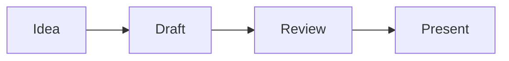

---
slides:
  formatVersion: 1
  title: Slides feature tour
  master:
    theme: signal
    footer: Made with Slides
    logo: Slides.
    metadata:
      metadataTopLeft: deckTitle
      metadataBottomLeft: footer
      metadataBottomRight: slideNumber
---

::slide{id="welcome" section="Welcome" layout="title-image-right" metadataBottomRight="none"}
# Your story, your slides

Write in Markdown. Edit locally. Present anywhere on your network.

:::slot{name="image"}

:::

:::notes
This tour is an ordinary, editable deck. Speaker notes stay private to the presenter.
:::

::slide{id="welcome-left" section="Welcome" layout="title-image-left" metadataTopLeft="none"}
# A cover with the image on the left

The image fills its half of the slide; choose either side in the layout selector.

:::notes
Switch between title-image-left and title-image-right to compare full-height image placement.
:::

:::slot{name="image"}

:::

::slide{id="story" section="Layout examples"}
# One source, many slide types

Choose a layout above any slide preview. Change the **section** in Slide settings to group related slides in the outline.

:::notes
Open the outline to show how sections group related slides without changing their source order.
:::

::slide{id="key-ideas" parent="story" section="Layout examples"}
# Heading and content

- Capture ideas as Markdown
- Rearrange slides in the source
- Use child slides for a deeper dive

This slide is a child of the preceding one. Use the tree navigation while presenting.

:::notes
Use Parent to return to One source, many slide types. The child remains next to its parent in the Markdown source.
:::

::slide{id="two-columns" section="Layout examples" layout="two-columns"}
# Two columns

:::notes
Each column is a named slot in this slide's Markdown. The audience sees only the rendered content.
:::

:::slot{name="left"}
## Write

Keep your message clear and direct.
:::

:::slot{name="right"}
## Show

Present the same source to a read-only audience.
:::

::slide{id="three-columns" section="Layout examples" layout="three-columns"}
# Three columns

:::notes
Use left, center, and right slots to keep three short ideas aligned.
:::

:::slot{name="left"}
## Plan

Start with a question.
:::

:::slot{name="center"}
## Build

Add examples and visuals.
:::

:::slot{name="right"}
## Share

Present and collaborate.
:::

::slide{id="picture-text" section="Image layouts" layout="picture-text"}
# Image beside text

:::notes
This layout pairs an image slot with a text slot rather than using a full-bleed image.
:::

:::slot{name="image"}

:::

:::slot{name="text"}
## Give the image context

Pair a visual with a short explanation.
:::

::slide{id="image-only" section="Image layouts" layout="image-full" metadataTopLeft="none" metadataBottomLeft="none" metadataBottomRight="none"}


:::notes
Use image-full when a visual should fill the entire stage. The provided image is bundled with Slides.
:::

::slide{id="comparison" section="Rich content"}
# Comparison table

| Slide format | Best for | Effort |
| --- | --- | --- |
| Title and content | A short message | Low |
| Columns | Side-by-side ideas | Medium |
| Full image | A visual pause | Low |
| Chart | Data with context | Medium |

:::notes
The table has bold headers and alternating row colors. Edit the Markdown cells to change its contents.
:::

::slide{id="code" section="Rich content"}
# Code with highlighting

```typescript title="slides.ts" showLineNumbers {2}
type Slide = { id: string; title: string };
const slides: Slide[] = [{ id: 'intro', title: 'Hello' }];
console.log(slides[0].title);
```

Code is highlighted, not executed.

:::notes
Fenced code gets syntax highlighting, a filename, a language badge, line numbers and highlighted lines from its fence meta. It is displayed as text and never runs in the presentation.
:::

::slide{id="math" section="Rich content"}
# Math

Inline math works: $a^2 + b^2 = c^2$.

$$E = mc^2$$

:::notes
Inline and block math are rendered from the Markdown source using KaTeX.
:::

::slide{id="cards" section="Components"}
# Cards and callouts

<Cards>
<Card title="Write">
Plain **Markdown** inside every card.
</Card>
<Card title="Rehearse">
Private notes stay with you.
</Card>
<Card title="Present">
Share read-only on your LAN.
</Card>
</Cards>

<Callout type="tip" title="MDX, kept static">
Components take string attributes only; nothing in the deck executes.
</Callout>

:::notes
Cards, card grids and callouts are built-in MDX-style components. Their attributes are plain strings and they never run code.
:::

::slide{id="terminal" section="Components"}
# Terminal and highlights

```terminal title="Start Slides"
$ bun install
$ bun run dev
Local Slides: http://127.0.0.1:4321
```

Every deck is <Mark note="no cloud">saved locally</Mark> as an MDX file.

:::notes
Terminal fences mark lines starting with a dollar prompt as commands. Mark highlights text and can attach a visible note.
:::

::slide{id="bar-chart" section="Charts" metadataTopCenter="slideTitle"}
# A bar chart

```chart
{"type":"bar","labels":["Discover","Build","Share"],"series":[{"name":"Projects","data":[3,8,12]}]}
```

This slide adds its title at the top center without changing the master.

:::notes
The chart is driven by inline JSON. Its data table remains available to screen readers but is not drawn below the chart.
:::

::slide{id="donut-chart" section="Charts"}
# A donut chart

```chart
{"type":"donut","labels":["Design","Build","Review"],"series":[{"name":"Time","data":[25,50,25]}]}
```

:::notes
The same chart data format supports other chart types, including donut, line, area, and scatter.
:::

::slide{id="perf-metrics" section="Charts" hideTitle="true" metadataTopRight="slideTitle"}
# Performance metrics

<Cards>
<Card title="p50 Latency">
**14 ms** <Mark note="-36%">target met</Mark>
</Card>
<Card title="p99 Latency">
**42 ms** across 4 regions
</Card>
<Card title="Throughput">
**18.4k** req/s sustained
</Card>
</Cards>

```chart
{"type":"line","labels":["W1","W2","W3","W4"],"series":[{"name":"Baseline (ms)","data":[68,64,61,59]},{"name":"Optimized (ms)","data":[58,49,44,42]}],"y":"p99 ms"}
```

:::notes
Combine multiple components on one slide, such as KPI summary cards above a live ECharts trend. Setting hideTitle="true" hides the slide heading on stage while keeping it in the outline, jump list, and slideTitle metadata.
:::

::slide{id="diagram" section="Diagrams"}
# A visible Mermaid flow



:::notes
Mermaid renders this left-to-right flow from idea to presentation. The diagram fits within the slide and leaves room for the footer.
:::

::slide{id="architecture-flow" section="Diagrams" metadataTopLeft="none"}
# Service-Level Machine Capacity — End-to-End 4-Plane Flow

[Runner PR #104](https://example.com/runner) · [Scheduler PR #105](https://example.com/scheduler) · [Service PR #108](https://example.com/service) · [Live Weekly Capacity UI](https://example.com/capacity)

<Flow>
<Lane title="1 · Workflow Plane">
<Step id="u1" title="U1 · Batch Submit / Weekly Cron">
Sub-test = Capacity (skips baseline)
</Step>
<Step id="u2" title="U2 · Auto-Lock + Pin + Deploy">
Locks client + downstream · opens TCP port
</Step>
<Step id="u3-trigger" title="U3 · TriggerCapacityTask (3.3s)" tone="accent">
1 fresh `.bin` (8h SAS) + host bindings

<Status tone="ok">Exits immediately (PendingCallback)</Status>
</Step>
<Step id="u9" title="U9 · Webhook → Pass + Unlock">
<Status tone="ok">Completed = Green Pass · 0 stuck locks</Status>
</Step>
</Lane>
<Lane title="2 · Orchestration Plane">
<Step id="u4" title="U4–U5 · POST /api/CapacityTests">
Stores JSON scenario · auto-maps profile
</Step>
<Step id="u6" title="U6 · Step Ramp + Auto-Stop">
StartQps → +StepQps → MaxQps

<Status tone="accent">StopOnBreach saves host locks</Status>
</Step>
<Step id="u8" title="U8 · Multi-Role Counter Isolation" tone="accent">
- Bound role: locked host validated
- Unbound role: env collected (non-fatal)
- Webhook + 3m reconciler backup
</Step>
</Lane>
<Lane title="3 · Load Agents & Telemetry">
<Step id="agents" title="U7 · Replay Agents (LoadGen)" tone="accent">
- Sequential `.bin` replay across N agents
- Copies `.bin` to local NVMe once (Step 1)
- <Status tone="ok">Retail speed · exact failure count</Status>
</Step>
<Step id="telemetry" title="Telemetry & Health Counters">
`AppStore_PS` → `app-node-01`

`Inference_GPU` → `gpu-node-04`
</Step>
</Lane>
<Lane title="4 · Locked Target Hosts">
<Step id="client-host" title="Client Host (Exclusive Lock)" tone="accent">
`app-node-01:4025/Service`

Candidate build + co-located sidecar

<Status tone="accent">89.6% CPU @ 5,160 Reached QPS</Status>
</Step>
<Step id="downstream-host" title="Downstream Host (Exclusive Lock)">
`gpu-node-04` (Model GPU)

Pinned 1:1 from service config
</Step>
</Lane>
<Arrow from="u3-trigger" to="u4" />
<Arrow from="u6" to="agents" />
<Arrow from="agents" to="client-host" />
<Arrow from="client-host" to="downstream-host" />
<Arrow from="downstream-host" to="telemetry" style="dashed" />
<Arrow from="telemetry" to="u8" />
<Arrow from="u8" to="u9" />
</Flow>

<Cards>
<Card title="DB Schema Changes">
<Status tone="accent">Zero (0 DDL)</Status>

Uses existing JSON columns
</Card>
<Card title="Worker Hold Time">
<Status tone="accent">3.3 Seconds</Status>

Webhook + 3m reconciler
</Card>
<Card title="QuerySet Strategy">
<Status tone="accent">1 Fresh .bin (8h SAS)</Status>

Reused across ramp steps
</Card>
<Card title="Gate Verdict">
<Status tone="accent">Completed = Pass</Status>

Threshold runs never false-fail
</Card>
<Card title="Workflows Wired">
<Status tone="accent">10 Pipelines (~35 Jobs)</Status>

Default capacity mode safe
</Card>
</Cards>

:::notes
Flow, Lane, Step, Arrow, and Status compose multi-plane architecture diagrams as native Markdown cards with auto-routed SVG connectors and a KPI summary strip below.
:::

::slide{id="pipeline-scale" section="Diagrams" metadataTopLeft="none"}
# High-QPS Replay Pipeline & Scaling Across ~30 Services

[LoadGen PR #109](https://example.com/loadgen)

<Flow>
<Step id="p1" title="1 · Shared Replay File">
Uses exact capture from query builder

`1 latest .bin (<= 3 days old)`

Shared via 8h read-only HTTPS SAS

<Status tone="ok">No older or stale captures mixed</Status>
</Step>
<Step id="p2" title="2 · Copy Once to Local Disk" tone="accent">
Matches local QuerySet cache model

Downloads once to NVMe on Step 1

Auto-cleans oldest unused cached files

<Status tone="ok">Step 2, 3, 4+ reuse local disk (0 network)</Status>
</Step>
<Step id="p3" title="3 · Parallel Agents (Dynamic N)">
Orchestrator adds agents as QPS ramps

Each agent starts at `(agentIndex / N)`

Reads sequentially & wraps around file

<Status tone="ok">Avoids N agents sending Query #1 together</Status>
</Step>
<Step id="p4" title="4 · Standard Managed Client">
- Exact wire protocol request bytes
- Streams off disk (no RAM OutOfMemory)
- Retail mode (`DebugMode="false"`)
- <Status tone="ok">Counts server-rejected replies as Failed</Status>
</Step>
<Arrow from="p1" to="p2" />
<Arrow from="p2" to="p3" />
<Arrow from="p3" to="p4" />
</Flow>

| Potential Scale Bottleneck (~30 Services) | Simple Plain-English Fix Built In |
| --- | --- |
| **1. Worker Waiting 40–60 Min** | <Status tone="ok">Fixed:</Status> Handoff completes in 3 seconds and immediately frees the worker; orchestrator posts completion webhook (backed by a 3-min reconciler). |
| **2. Storage Slowdown on Large `.bin` Files** | <Status tone="ok">Fixed:</Status> Each agent VM downloads the fresh `.bin` to local NVMe only once on Step 1 and reuses it on Step 2+ (0 re-downloading), staggered to 2–3 concurrent runs. |
| **3. Load Generator Crashing on Huge Payloads** | <Status tone="ok">Fixed:</Status> Streams queries straight off local disk (~2 MB RAM instead of loading >2 GB into RAM) and spreads heavy services across multiple agent VMs (3,000 QPS per VM). |
| **4. Holding Scarce Downstream GPU Hosts Too Long** | <Status tone="ok">Fixed:</Status> `StopOnBreach` halts stepping the moment a bound machine hits its limit and immediately unfreezes + unlocks both the client and GPU hosts. |

:::notes
Place Step cards directly inside Flow without Lane wrappers to build a horizontal step-by-step pipeline with routed arrows above a detailed comparison or bottleneck table.
:::

::slide{id="portal-panels" section="Diagrams" metadataTopLeft="none"}
# Step U4: Previous Runs List · Step U5: Capacity Run Summary (#6798)

<Status tone="accent">U4 Overview:</Status> Lists all triggered runs with 1-click origin link | <Status tone="accent">U5 Summary:</Status> Shows locked `Host:Port/Service`, SAS URL & telemetry links

<Panels>
<Panel title="Step U4 · Previous Runs" href="https://example.com/overview" link="capacity-portal/overview#single-host" footer="Tip: If a cold deep link shows the welcome screen, click Capacity Testing top-left once.">
| Run Name | Environment | Status | Reached QPS |
| --- | --- | --- | --- |
| `[PPE] PR 7401 smoke` | `Service-Prod-01` | <Status tone="ok">Completed</Status> | `344` |
| `[PPE] PR 7401 parity` | `Service-Prod-01` | <Status tone="ok">Completed</Status> | `332` |
| `[WR46] Combined run-3` | `Service-Prod-01` | <Status tone="muted">Aborted</Status> | `237` |
| `[WR46] Combined run-1` | `Service-Prod-01` | <Status tone="accent">Threshold</Status> | `309` |


</Panel>
<Panel title="Step U5 · Run #6798 Basic Info" href="https://example.com/report/6798" link="capacity-portal/report-summary/6798" footer="Direct buttons at bottom of Basic Info jump straight to Workflow Run and Host Telemetry.">
| Field | Value |
| --- | --- |
| **Product / Mode** | `[SingleBox] Service Capacity (Run #1479)` |
| **Locked Endpoint** | `app-node-01:4025/Service` (`US`) |
| **Throughput Ramp** | `6,000` start → `12,000` max QPS |
| **Final Status** | <Status tone="ok">Completed</Status> — stopped cleanly at threshold |


</Panel>
</Panels>

:::notes
Panels and Panel frame side-by-side screenshots, portal views, or tables with a linked header bar and a persistent tip/caption strip along the bottom.
:::

::slide{id="reveal" section="Presenting"}
# A reveal and private notes

Advance once to reveal the next point.

:::reveal{step="1"}
This point appears only after the first advance.
:::

:::notes
The audience cannot see this instruction or the owner-side source file.
:::

::slide{id="finish" section="Presenting" layout="blank" metadataBottomRight="none"}

:::notes
The blank slide can be used as a pause. Return to the editor to customize this tour.
:::
