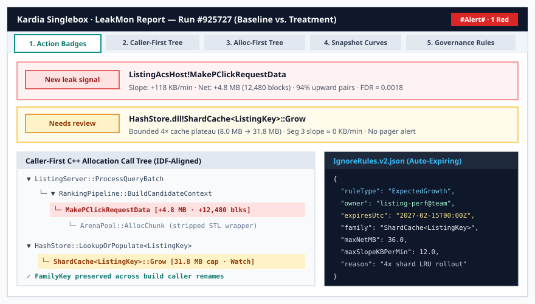

---
slides:
  formatVersion: 1
  title: The LeakMon Evolution Journey
  master:
    theme: signal
    surface: "#f8fafc"
    text: "#0f172a"
    accent: "#0d9488"
    muted: "#475569"
    footer: Kardia Singlebox · LeakMon Evolution Journey (Jan – Nov 2026)
    metadata:
      metadataBottomLeft: footer
      metadataBottomRight: slideNumber
---

::slide{id="hero" section="Overview" theme="midnight" eyebrow="KARDIA SINGLEBOX · JAN – NOV 2026" subtitle="From Manual Heap Dumps to Fleet-Wide C++ Memory Leak Detection"}
# The LeakMon Journey

How two parallel tracks—global workflow automation and three generations of statistical detection—turned noisy C++ memory traces into fast, trusted pre-production guardrails.

<Cards columns="3">
<Card tone="blue" stat="73 + 65" title="Automated Recurring Runs">

73 live Mon/Wed/Fri schedules + 65 weekly 65-min DELite sign-off runs across 10 E2E XMLs.

</Card>
<Card tone="teal" stat="92.9% / 83.6%" title="Leak / Regression Accuracy">

Up from 78.0% / 55.2% on 333 ground-truth runs; sawtooth batch leaks jumped 0% → 96.4%.

</Card>
<Card tone="amber" stat="30.5% → 4.4%" title="Historical Replay Alert Rate">

85% drop in flagged Singlebox runs (Batch 18: 23.4% → 0.8%) & -50% background false alerts.

</Card>
</Cards>

:::notes
LeakMon began after January 2026 production memory leaks in Gene and PA services. Over ten months, two parallel tracks scaled automated ETW heap tracking fleet-wide while cutting noisy alerts by 85%.
:::

::slide{id="big-picture" section="Overview" eyebrow="THE BIG PICTURE" subtitle="Started after Jan 2026 production leaks in Gene & PA services — built to catch leaks before code ships."}
## From Manual Firefighting to Two Parallel Engineering Tracks

<Cards columns="2">
<Card tone="red" title="Manual, Reactive Debugging">

<Badge tone="red">JAN 2026 · BEFORE</Badge>

- Log onto Singlebox machines manually after prod incidents
- Copy multi-megabyte raw ETW text dumps off the box
- Eyeball C++ call stacks with no Baseline vs. Treatment diff

</Card>
<Card tone="teal" title="Automated Pre-Prod Guardrails">

<Badge tone="teal">NOV 2026 · TODAY</Badge>

- Side-by-side Baseline vs. Treatment capture under live load
- 40 snapshots (20m) MWF + 123 snapshots (65m) DELite sign-off
- Plain-English Kardia UI badges, call trees & red-alert gating

</Card>
</Cards>

<Flow layout="rows" tone="teal">
<Lane title="Track 1 · Task Pipeline & Fleet Scale" subtitle="1 opt-in workflow → 10 E2E XMLs, 46 schedulers across US/EMEA/APAC & WaaS" tone="blue">
<Step id="t1-w0" title="Mar–Apr" badge="Wave 0">
6-Task Pipeline & Linnet Wave 0
</Step>
<Step id="t1-w2" title="Jun–Jul" badge="Global MWF">
Gene, Listing, PA, PClick, Queene + MWF
</Step>
<Step id="t1-w4" title="Aug–Sep" badge="DELite 65m">
65-min DELite, Gating & 363-Context Isolation
</Step>
<Step id="t1-w5" title="Nov" tone="blue" badge="+WaaS">
WaaS CPU/GPU, QPS Tuning & Fast Unlock
</Step>
</Lane>
<Lane title="Track 2 · Detection & Comparison Engine" subtitle="Three algorithm generations validated across 4,587 real & simulated pairs" tone="teal">
<Step id="t2-g1" title="Gen 1 (Jan–Aug)" badge="30.5% Alerts">
OLS Straight Line & Word-Bag
</Step>
<Step id="t2-g2" title="Gen 2 (Sept 15)" badge="17.7% Alerts">
Median Slope, MSER-5 & Floor
</Step>
<Step id="t2-sim" title="Sim + 5 Exps" badge="280 Runs">
12 Leak Shapes & Ablation Tradeoffs
</Step>
<Step id="t2-g3" title="Gen 3 (Nov 17–18)" tone="teal" badge="4.4% Alerts">
Sawtooth, Plateaus & Refactors
</Step>
</Lane>
<Arrow from="t1-w0" to="t1-w2" />
<Arrow from="t1-w2" to="t1-w4" />
<Arrow from="t1-w4" to="t1-w5" />
<Arrow from="t2-g1" to="t2-g2" />
<Arrow from="t2-g2" to="t2-sim" />
<Arrow from="t2-sim" to="t2-g3" />
</Flow>

:::notes
Track 1 solved fleet orchestration and clean ETW trace capture; Track 2 iterated through three statistical detection engines backed by a 12-shape C++ simulator.
:::

::slide{id="pipeline-stages" section="Track 1 · Fleet Pipeline" eyebrow="TRACK 1 · TASK ARCHITECTURE" subtitle="Designed to isolate ETW capture, release scarce Singlebox machines early, and fail closed on bad data."}
## How a LeakMon Run Works: Five Decoupled Pipeline Stages

<Flow tone="blue">
<Step id="s1" title="1. Trigger Capture" badge="TriggerLeakMonTask">
Waits 100–120s for steady traffic, syncs PDBs & runs `LeakMon.exe` every 30s on both arms.
</Step>
<Step id="s2" title="2. Per-Side Upload" badge="CosmosUpload ×2">
Zips only the current test ID's trace files so stale logs on reused boxes are never included.
</Step>
<Step id="s3" title="3. Unlock + Parse" tone="teal" badge="LeakMonAnalysis ×2">
Boxes unlock immediately! Offline workers repair text, parse 64-bit counts & fit trends.
</Step>
<Step id="s4" title="4. Compare & Gate" badge="LeakMonCompare">
Aligns timestamps, pairs C++ stacks, checks service rules & emits red `#Alert#` on regressions.
</Step>
<Step id="s5" title="5. Visual Triage" tone="blue" badge="Kardia UI (5 Tabs)">
Plain-English badges for 2-minute triage, plus full stats & interactive C++ Call Trees.
</Step>
<Arrow from="s1" to="s2" />
<Arrow from="s2" to="s3" />
<Arrow from="s3" to="s4" />
<Arrow from="s4" to="s5" />
</Flow>

<Cards columns="3">
<Card tone="blue" eyebrow="SAFEGUARD 1" title="8 Fail-Closed Per-Side Flags">

Comparison only runs when **both** Baseline & Treatment independently confirm capture, upload, valid JSON, and snapshot counts.

</Card>
<Card tone="teal" eyebrow="SAFEGUARD 2" title="Zero Benchmark Pollution">

`PerfReportTask`, Azure CPU Profiler, and Response Parity stay disabled during LeakMon runs—no ETW buffer or latency interference.

</Card>
<Card tone="amber" eyebrow="SAFEGUARD 3" title="Faster Machine Pool Turnover">

Heavy ZIP parsing, statistical fitting, and C++ stack matching run offline right after unlocking scarce Singlebox test hosts.

</Card>
</Cards>

:::notes
Decoupling capture from analysis let Singlebox test machines return to the shared pool as soon as traces upload, while 8 per-side health flags prevent partial captures from producing false diffs.
:::

::slide{id="fleet-scale" section="Track 1 · Fleet Pipeline" eyebrow="TRACK 1 · SCALE & HARDENING IMPACT" subtitle="Five rollout waves across US, EMEA, APAC & WaaS — paired with QPS tuning and fail-closed parser upgrades."}
## Scaling From 1 Workflow to Global Fleet & Fixing Corrupt Traces

<Split ratio="56-44">
<Card tone="teal" title="Fleet Schedule Growth Across 5 Waves (2026)" subtitle="Active Mon/Wed/Fri Singlebox schedules + weekly 65-min DELite sign-off runs" footer="Footprint: 10 E2E XML templates · 46 schedulers · Top-25 stacks fleet-wide">

```chart
{
  "type": "bar",
  "labels": ["Mar (W0)", "May (W1)", "Jul (W3)", "Aug (W4)", "Nov (W5)"],
  "yMax": 90,
  "showValues": true,
  "series": [
    { "name": "Live MWF Recurring Jobs", "data": [1, 15, 56, 71, 73], "color": "#0284c7" },
    { "name": "Weekly 65-Min DELite Runs", "data": [0, 0, 0, 52, 65], "color": "#0d9488" }
  ],
  "annotations": [
    { "x": "Nov (W5)", "y": 73, "seriesIndex": 0, "text": "138 total runs/wk (+WaaS)", "tone": "teal", "dx": -35, "dy": -26 }
  ]
}
```

</Card>
<Stack>
<Card tone="blue" stat="1.5B → 0" title="Lost ETW Events Eliminated on Caique US">

Fleet ETW audit tuned QPS on 4 heavy services (e.g., Caique US 2000 → 1000 QPS), restoring 100% stack-walk capture.

</Card>
<Card tone="teal" stat=">6.3B Allocs" title="64-Bit Pipeline & Duplicate-Stack Merging">

Fixed `Int32` crashes above 2.1B allocations and summed split duplicate stacks per snapshot that previously hid real leaks.

</Card>
<Card tone="amber" stat="Fail-Closed" title="Corrupted Async Text Repair">

Caught `'Processed 886298000 events'` landing mid-line (fabricating `Events Lost: 8` on JennyGene) — now fails closed safely.

</Card>
</Stack>
</Split>

:::notes
Scaling to 138 recurring weekly runs exposed three critical infrastructure edge cases: ETW event drops at ultra-high QPS, 32-bit allocation counter overflow above 2.1B allocations, and interleaved stdout status lines.
:::

::slide{id="gen1-limits" section="Track 2 · Detection Engine" eyebrow="TRACK 2 · GENERATION 1 (JAN – AUG 2026)" subtitle="Gen 1 drew average lines (OLS) and matched unordered words — flagging 1,000 of 3,284 runs (3,997 stacks)."}
## Why Simple Straight Lines Cried Wolf on 30.5% of Runs

<Cards columns="2">
<Card tone="red" title="1. One Spike Ruins an Average Line (OLS)" subtitle="One late cache reload tilted y = mx + b past 100 B/s and triggered a false Leak.">

```chart
{
  "type": "line",
  "labels": ["2.5", "5.0", "7.5", "10.0", "12.5", "15.0", "17.5", "20.0"],
  "x": "Capture Time (minutes)",
  "y": "MB",
  "yMax": 27,
  "series": [
    { "name": "30s Snapshots", "data": [11.8, 12.0, 11.9, 12.1, 12.0, 12.1, 23.4, 12.1], "color": "#64748b" },
    { "name": "Gen 1 OLS (False Leak)", "data": [10.8, 11.6, 12.4, 13.2, 14.0, 14.8, 15.6, 16.4], "color": "#dc2626", "style": "dashed" },
    { "name": "Gen 2/3 Median (Clean)", "data": [11.9, 11.9, 12.0, 12.0, 12.0, 12.0, 12.1, 12.1], "color": "#059669" }
  ],
  "annotations": [
    { "x": "17.5", "y": 23.4, "text": "1 late cache spike", "tone": "red", "dx": -72, "dy": -8 }
  ]
}
```

</Card>
<Card tone="amber" title="2. The 'Top-25 Cutoff' Visibility Trap" subtitle="14.9 MB (#26, hidden) on Baseline vs. 15.1 MB (#25, printed) looked brand new.">

```chart
{
  "type": "bar",
  "labels": ["Baseline Stack X", "Treatment Stack X"],
  "y": "MB",
  "yMax": 22,
  "showValues": true,
  "valueSuffix": " MB",
  "series": [
    { "name": "Observed in Top-25 Log", "data": [14.9, 15.1], "color": "#94a3b8", "pointColors": ["#94a3b8", "#dc2626"] }
  ],
  "lines": [
    { "y": 15.0, "label": "Top-25 Cutoff (15.0 MB)", "color": "#d97706", "style": "dashed" }
  ],
  "zones": [
    { "yMin": 0, "yMax": 15.0, "label": "Rank #26+ Zone (Unprinted in Log)", "color": "#94a3b8" }
  ],
  "annotations": [
    { "x": "Baseline Stack X", "y": 14.9, "seriesIndex": 0, "text": "Gen 1 saw '0 MB' → False Leak!", "tone": "red", "dx": 28, "dy": -32 }
  ]
}
```

</Card>
</Cards>

<Cards columns="3">
<Card tone="blue" title="3. Blind to Piece Counts">

Only checked bytes—so allocating **one** 8 MB hash table (1 block) looked identical to leaking 8,000 small chunks.

</Card>
<Card tone="amber" title="4. Fixed 30% Warmup Cut">

Blindly dropped 30% of snapshots—too short when pre-attach `'orphan frees'` churned slowly, wasteful on fast services.

</Card>
<Card tone="red" title="5. Inverted .dll Filter & Coin Flips">

Early bug stripped product `.dll` frames (fixing it cut 91-run flags 60 → 15, -75%). Testing 30 stacks unadjusted caused noise.

</Card>
</Cards>

:::notes
Ordinary Least Squares has a 0% breakdown point: a single late cache reload tilts the fitted slope across the threshold. Combined with Top-25 log censoring, 30.5% of historical Singlebox runs cried wolf.
:::

::slide{id="gen2-rewrite" section="Track 2 · Detection Engine" eyebrow="TRACK 2 · GENERATION 2 REWRITE (SEPT 15, 2026 · PR 7105485)" subtitle="Deleted 21,751 lines of brittle rules; rebuilt around non-parametric statistics — cutting alerts 30.5% → 17.7%."}
## Replacing Heuristics With Outlier-Proof Statistical Gates

<Split ratio="58-42">
<Card tone="teal" title="Five Core Pillars of the September Rewrite">

<Steps>
<StepItem num="1" tone="teal" title="Outlier-Proof Median Slope (Theil-Sen + Mann-Kendall)">
Takes the middle slope across all snapshot pairs so spikes can't corrupt it; requires ≥65% upward pairs + FDR < 5%.
</StepItem>
<StepItem num="2" tone="teal" title="Auto-Detected Warmup (MSER-5) & Real Size Floors">
Slides warmup cutoff to where startup turbulence settles; requires ≥64 KB/min slope AND ≥2 MB net climb.
</StepItem>
<StepItem num="3" tone="blue" title="Counting Pieces, Not Just Bytes ('One-Time Load')">
If bytes jump ≥1 MB across ≤64 large chunks (≥256 KB) and piece count is flat, labels it `'One-time increase'`.
</StepItem>
<StepItem num="4" tone="blue" title="Solving the Top-25 Cutoff ('WouldHaveBeenPrinted')">
Before calling an unmatched stack a New Leak, verifies its size clears Baseline's #25 floor in ≥95% of snapshots.
</StepItem>
<StepItem num="5" tone="green" title="Order-Aware Stack Matching & Whole-Process Gate">
Preserves C++ call order (IDF-weighted LCS) and only flags a Regression when total monitored heap also grew worse.
</StepItem>
</Steps>

</Card>
<Stack>
<Card tone="dark" eyebrow="GEN 2 SCORECARD" stat="30.5% → 17.7%">

- **583 / 3,288** Singlebox runs flagged (**-42%**)
- **78.0% Leak / 55.2% Regression** accuracy
- Added service `IgnoreRules` & interactive Call Trees

</Card>
<Card tone="amber">

<Badge tone="amber">WHAT STILL SLIPPED THROUGH?</Badge>

- **0%** of `'Sawtooth'` batch leaks caught (labeled `'Mixed'`)
- Erasing C++ `<Templates>` merged unrelated pools (1,424 Regs)
- Caller renames across builds fired false New Leaks
- Paired by snapshot `#` instead of clock time; missed plateaus

</Card>
</Stack>
</Split>

:::notes
Generation 2 deleted over 21K lines of ad-hoc heuristics in favor of Theil-Sen median slopes, MSER-5 warmup detection, and Top-25 floor verification—cutting noisy alerts by 42% while exposing four subtler C++ blind spots.
:::

::slide{id="ablation-validation" section="Track 2 · Detection Engine" eyebrow="TRACK 2 · SCIENTIFIC VALIDATION (NOV 2026)" subtitle="Built a 12-shape C++ Memory Simulator across 14+ services + replayed 4,587 real & synthetic workflow pairs."}
## Testing 5 Competing Hypotheses Before Shipping Generation 3

<Split ratio="56-44">
<Card tone="blue" title="Precision & Recall Across Experiments (280 Shape-Matched Runs)" subtitle="Ablation caught two plausible-sounding ideas (Exp 2 & Exp 3) that caused severe regressions">

```chart
{
  "type": "bar",
  "labels": ["Gen 2 Ref", "Exp 1 (Tmpl)", "Exp 2 TRAP", "Exp 3 TRAP", "Gen 3 Final"],
  "y": "Score (%)",
  "yMax": 124,
  "showValues": true,
  "valueSuffix": "%",
  "series": [
    { "name": "Leak Recall (%)", "data": [76, 76, 66, 95, 93], "color": "#0284c7" },
    { "name": "Regression Recall (%)", "data": [51, 51, 33, 80, 83], "color": "#0d9488", "pointColors": [null, null, "#dc2626", null, null] },
    { "name": "Leak Precision (%)", "data": [59, 76, 97, 67, 86], "color": "#059669", "pointColors": [null, null, null, "#d97706", null] }
  ],
  "annotations": [
    { "x": "Exp 2 TRAP", "y": 33, "seriesIndex": 1, "text": "TRAP #1: Reg Recall 32.6%", "tone": "red", "dx": -12, "dy": -92 },
    { "x": "Exp 3 TRAP", "y": 67, "seriesIndex": 2, "text": "TRAP #2: +1,280 hist. leaks", "tone": "amber", "dx": -8, "dy": -52 },
    { "x": "Gen 3 Final", "y": 93, "seriesIndex": 1, "text": "Winner: 4.4% alerts", "tone": "green", "dx": -6, "dy": -26 }
  ]
}
```

</Card>
<Stack>
<Card tone="blue" title="12-Shape C++ Simulator in Live Services">

<Badge tone="blue">GROUND TRUTH</Badge>

Injected Linear, Staircase, Sawtooth, Superlinear, Ratchet, Sporadic & Bounded Plateaus in Leak (168) & Regression (165) modes.

</Card>
<Card tone="red" title="Exp 2: AR(1) Penalty Crushed Recall to 32.6%">

<Badge tone="red">TRAP #1 CAUGHT</Badge>

Adjusting sample size for `AR(1)` correlation mistook smooth curved/staircase leaks for `'correlated noise'` (`N → 4`). Dropped!

</Card>
<Card tone="amber" title="Exp 3: Raw Lambdas Added +1,280 False Leaks">

<Badge tone="amber">TRAP #2 CAUGHT</Badge>

Keeping MSVC `??@hex@` lambda IDs rescued sawtooth leaks, but split async stacks across builds. Fixed by normalizing lambdas only!

</Card>
</Stack>
</Split>

:::notes
Without controlled ablation on 280 synthetic + 4,235 historical runs, both AR(1) effective-sample-size correction and raw MSVC symbol retention looked attractive on paper—yet each caused catastrophic recall or precision regressions.
:::

::slide{id="gen3-breakthroughs" section="Track 2 · Detection Engine" eyebrow="TRACK 2 · GENERATION 3 BREAKTHROUGHS (NOV 17–18, 2026)" subtitle="Four core upgrades shipped in PRs 7384917, 7386520 & 7400860 to boost recall while halving background noise."}
## How Generation 3 Solves Real-World C++ Memory Blind Spots

<Cards columns="2">
<Card tone="teal" title="1. 'Connect the Valleys' Catches Sawtooth Leaks (0% → 96.4%)" subtitle="Finds the lowest point in ~6 consecutive sample buckets + checks rising block counts (27/28 Shape 4).">

```chart
{
  "type": "line",
  "labels": ["1", "3", "5", "7", "9", "11", "13", "15", "17", "19", "21", "23", "25"],
  "x": "Snapshots Across Batch Cycles",
  "y": "MB",
  "yMax": 22,
  "series": [
    { "name": "Raw Batch Cycles (Gen 2 Missed 100%)", "data": [3.8, 11.8, 5.0, 13.0, 6.2, 14.2, 7.4, 15.4, 8.6, 16.6, 9.8, 17.8, 11.0], "color": "#64748b" },
    { "name": "Gen 3 Valley Trend (27/28 = 96.4%)", "data": [3.8, 4.4, 5.0, 5.6, 6.2, 6.8, 7.4, 8.0, 8.6, 9.2, 9.8, 10.4, 11.0], "color": "#059669", "area": true }
  ],
  "annotations": [
    { "x": "21", "y": 9.8, "text": "Rising floor: +96.4% caught", "tone": "green", "dx": -55, "dy": 22 }
  ]
}
```

</Card>
<Card tone="amber" title="2. 3-Segment Check Separates Cache Plateaus (1/14 → 14/14)" subtitle="Spots flattening caches (late slope ≤62% of early) & censored baselines → routes to Watch, never Leak.">

```chart
{
  "type": "line",
  "labels": ["2.5", "5.0", "7.5", "10.0", "12.5", "15.0", "17.5", "20.0"],
  "x": "Capture Time (minutes)",
  "y": "MB",
  "yMax": 38,
  "series": [
    { "name": "Treatment Cache (32 MB → Watch)", "data": [14.0, 22.8, 27.2, 29.6, 30.8, 31.4, 31.7, 31.8], "color": "#b45309" },
    { "name": "Baseline Cache (8 MB Cap)", "data": [4.5, 6.4, 7.3, 7.7, 7.9, 8.0, 8.0, 8.0], "color": "#0284c7" }
  ],
  "lines": [
    { "x": "7.5", "label": "Seg 1 → Seg 2", "color": "#94a3b8", "style": "dashed" },
    { "x": "15.0", "label": "Seg 3: Flat Cap", "color": "#b45309", "style": "dashed" },
    { "y": 7.2, "label": "Top-25 Floor (7.2 MB)", "color": "#475569", "style": "dotted" }
  ],
  "annotations": [
    { "x": "17.5", "y": 31.7, "text": "4x Higher Cap (End slope ≈ 0)", "tone": "amber", "dx": -62, "dy": 30 }
  ]
}
```

</Card>
<Card tone="blue" title="3. C++ Domain Matching, Refactor Guard & Clock Alignment">

- Strips 40+ STL/Arena wrappers & keeps C++ `<Template>` types distinct
- `FamilyKey` sums top-3 domain functions so caller renames stay clean
- Hirschberg aligns clock time (±45s) in 104 KB RAM vs. 61 MB 2D table

</Card>
<Card tone="teal" title="4. Warmup Convergence Cap & 'Leftover Budget' Attribution">

- Caps warmup once orphan frees settle (≤200/s, ≤2%) to keep early leaks
- Subtracts big known jumps first so tiny stacks can't piggyback on heap
- Promotes strong block-backed leaks (`p < 0.005`) despite background dips

</Card>
</Cards>

:::notes
Connecting bucket minima turns oscillating batch sawtooth leaks into a clean monotonic trend (0% -> 96.4% catch rate), while 3-segment curvature testing routes bounded LRU caches to amber Watch instead of paging on-call engineers.
:::

::slide{id="measured-impact" section="Impact & Governance" eyebrow="MEASURED IMPACT · ACCURACY & SIGNAL-TO-NOISE" subtitle="Evaluated across 4,235 historical workflow replays and 333 ground-truth synthetic service runs."}
## Higher Leak Detection With 85% Fewer Flagged Historical Runs

<Cards columns="2">
<Card tone="teal" title="Historical Replay Alert Rate (Lower = Less Noise)" subtitle="% of historical runs with ≥1 Leak or Regression (not live FP rate)">

```chart
{
  "type": "bar",
  "labels": ["Gen 1 (Saved Base)", "Gen 2 (Sept Rewrite)", "Gen 3 (Nov Final)"],
  "yMax": 38,
  "showValues": true,
  "valueSuffix": "%",
  "series": [
    { "name": "Singlebox Fleet (3,288 runs)", "data": [30.5, 17.7, 4.4], "color": "#0284c7" },
    { "name": "Weekly DELite (947 runs)", "data": [28.1, 23.3, 6.1], "color": "#0d9488" }
  ],
  "annotations": [
    { "x": "Gen 3 (Nov Final)", "y": 4.4, "seriesIndex": 0, "text": "-85% noisy runs", "tone": "teal", "dx": -18, "dy": -36 }
  ]
}
```

</Card>
<Card tone="green" title="Ground-Truth Synthetic Catch Rate (Higher = Better)" subtitle="Gen 2 (Sept Ref) vs. Gen 3 (Nov) across 333-run & shape cohorts">

```chart
{
  "type": "bar",
  "labels": ["New Leak (168)", "Regression (165)", "Sawtooth (S4)", "Plateaus (S8)"],
  "yMax": 118,
  "showValues": true,
  "valueSuffix": "%",
  "series": [
    { "name": "Gen 2 (Sept Ref)", "data": [78.0, 55.2, 0.0, 7.1], "color": "#94a3b8" },
    { "name": "Gen 3 (Nov Final)", "data": [92.9, 83.6, 96.4, 100.0], "color": "#059669" }
  ],
  "annotations": [
    { "x": "Sawtooth (S4)", "y": 96.4, "seriesIndex": 1, "text": "0% → 96.4%", "tone": "green", "dx": -16, "dy": -24 }
  ]
}
```

</Card>
</Cards>

<Cards columns="4">
<Card tone="blue" stat="23.4% → 0.8%" title="Batch 18 Replay Alerts">

114 → 4 of 488 runs flagged

</Card>
<Card tone="teal" stat="1,351 → 170" title="DELite Actionable Stacks">

-87% weekly triage volume

</Card>
<Card tone="green" stat="86 → 43 (-50%)" title="Background False Alerts">

Across 313 / 333 clean runs

</Card>
<Card tone="amber" stat="3.9× Smaller" title="Amber 'Watch' Clutter">

2.1× smaller on Regressions

</Card>
</Cards>

:::notes
Across 3,288 Singlebox replays, flagged runs dropped from 30.5% in Gen 1 to 4.4% in Gen 3, while ground-truth synthetic catch rates simultaneously climbed to 92.9% on New Leaks and 83.6% on Regressions.
:::

::slide{id="ux-governance" section="Impact & Governance" eyebrow="DEVELOPER EXPERIENCE & GOVERNANCE" subtitle="Engineers see simple action badges first — with 5-tab Call Trees and owner-governed ceilings underneath."}
## Plain-English UI Badges, Real Service Wins & Expiring Rules

<Split ratio="48-52">
<Card tone="blue" title="Kardia Report Badges (Basic Mode)" subtitle="Only high-confidence red badges page teams or fail bucket health">

| Badge | Paging & Triage Semantics |
| --- | --- |
| <Badge tone="red">Faster memory growth</Badge> | **RED `#Alert#`** · Matched stack growing faster in Treatment — inspect diff. |
| <Badge tone="red">New leak signal</Badge> | **RED `#Alert#`** · Rising or sawtooth stack clearing Baseline's Top-25 floor. |
| <Badge tone="amber">Needs review</Badge> | **No Page** · Higher bounded cache plateau, fuzzy match, or growing refactor. |
| <Badge tone="blue">One-time increase</Badge> | **Info Only** · Step/table load (high bytes, flat block count) — not a leak. |
| <Badge tone="green">Less growth / Resolved</Badge> | **Positive** · Confirmed heap reduction or baseline leak no longer seen. |

</Card>
<Stack>
<Card tone="green" eyebrow="TOUCAN · RUN 895559" title="Caught 2 Real Arena Leaks Gen 1 Dismissed">

Gen 1 split duplicate snapshot rows into a fake sawtooth (`'memory reused'`). Gen 2/3 summed per-snapshot duplicates, cleared the 131 KB floor & caught both.

</Card>
<Card tone="teal" eyebrow="LISTING (925727) & KIWI / CAIQUE PA / AHQUEENE" title="Isolated DLL Leaks & 1 GB+ Cache Plateaus">

Paired `HashStore.dll` cache regression + isolated `MakePClickRequestData` leak; on 1 GB+ heaps, surfaced 4× cache caps hidden under Top-25 as Watch.

</Card>
<Card tone="purple" eyebrow="GOVERNANCE SCHEMA V2" title="Auto-Expiring 'ExpectedGrowth' Ceilings">

Teams check in intentional growth caps with mandatory `Owner`, `Reason`, `ExpiresUtc` & byte/slope ceilings—auto-alerts again if breached or expired!

</Card>
</Stack>
</Split>

:::notes
Press Down Arrow (or next) to inspect the child deep-dive slide showing Kardia's 5-tab Call Tree portal alongside the full Generation 1-to-3 architectural comparison matrix.
:::

::slide{id="kardia-portal-deep-dive" parent="ux-governance" section="Impact & Governance" eyebrow="DEEP DIVE · KARDIA 5-TAB PORTAL & GENERATION MATRIX" subtitle="Child drill-down slide pairing the live Kardia Call Tree UI with the Gen 1 → Gen 2 → Gen 3 evolution table."}
## Inside Kardia's 5-Tab Triage View & Engine Evolution

<Panels>
<Panel title="Kardia 5-Tab Triage & Governance v2" href="https://example.com/kardia/leakmon/925727" link="Run #925727" footer="Tip: Basic Mode shows plain-English badges first; Caller-First & Alloc-First Call Trees pinpoint exact C++ owners.">



</Panel>
<Panel title="Engine Evolution Matrix (Gen 1 → Gen 3)" footer="Evaluated across 3,288 Singlebox runs, 947 DELite runs & 333 synthetic ground-truth runs.">

| Capability | Gen 1 (Jan–Aug) | Gen 2 (Sept 15) | Gen 3 (Nov Final) |
| --- | --- | --- | --- |
| **Trend estimator** | OLS `y = mx + b` | Theil-Sen + MK | <Status tone="ok">Valley-Connect + 3-Seg</Status> |
| **Stack identity** | Unordered word-bag | IDF LCS (`<T>` erased) | <Status tone="ok">Template-aware + `FamilyKey`</Status> |
| **Warmup handling** | Fixed 30% cut | Auto MSER-5 | <Status tone="ok">Orphan-free convergence cap</Status> |
| **Sawtooth catch** | 0.0% | 0.0% (`Mixed`) | <Status tone="ok">96.4% (27 / 28)</Status> |
| **Plateau accuracy** | False `#Alert#` | 7.1% (1 / 14) | <Status tone="ok">100.0% → Watch</Status> |
| **Fleet alert rate** | 30.5% | 17.7% (-42%) | <Status tone="ok">4.4% (-85%)</Status> |

</Panel>
</Panels>

:::notes
This child slide demonstrates 2D hierarchical drill-down in Slides alongside framed side-by-side <Panels>, authorized SVG deck assets, and status-annotated comparison tables.
:::

::slide{id="summary-horizon" section="Summary" theme="midnight" eyebrow="SUMMARY & NEXT STEPS" subtitle="Simple workflows, rigorous statistics, and actionable answers before memory regressions reach production."}
## Ten Months From Manual Dumps to Trusted Fleet Guardrails

<Cards columns="3">
<Card tone="blue" eyebrow="01 · FLEET SCALE" stat="73 MWF + 65 DELite" title="Fleet-Wide, Zero-Friction Scale">

- 10 E2E workflow XMLs & 46 schedulers across US, EMEA, APAC & WaaS
- 363 contexts isolated from CPU profiler & benchmark side-effects
- Early machine unlock + 8 fail-closed flags keep Singlebox pools fast

</Card>
<Card tone="green" eyebrow="02 · STATISTICAL RIGOR" stat="92.9% Leak · 4.4% Alerts" title="High Catch Rate, Low Noise">

- Outlier-proof median slopes + Top-25 visibility floor + piece counts
- Sawtooth batch leaks jumped 0% → 96.4%; bounded plateaus 7.1% → 100%
- 85% drop in historical flagged runs & -50% background false stack alerts

</Card>
<Card tone="amber" eyebrow="03 · HUMAN TRIAGE" stat="5-Tab UI + Governance v2" title="Built for Fast Human Triage">

- Plain-English badges separate urgent red leaks from amber cache reviews
- Caller-first & Allocation-first Call Trees pinpoint the exact C++ owner
- Auto-expiring `ExpectedGrowth` ceilings prevent permanent blind spots

</Card>
</Cards>

<Cards columns="3">
<Card tone="blue" eyebrow="NEXT HORIZON · PR 7381839" title="ETW Startup Hardening">

Fail closed when pre-existing ETW sessions block attach on shared hosts.

</Card>
<Card tone="teal" eyebrow="NEXT HORIZON · PR 7388970" title="One-Time Load Banner">

Surface step increases at priority #2 with a dedicated top UI summary banner.

</Card>
<Card tone="purple" eyebrow="NEXT HORIZON · ULTRA-HIGH QPS" title="Ultra-High-QPS Capture">

Mitigate residual ETW stack-walk loss on high-rate Caique Linnet workloads.

</Card>
</Cards>

:::notes
Ten months took LeakMon from manual post-incident heap dumps to 138 automated weekly runs with 92.9% leak recall and 4.4% historical alert rate.
:::
